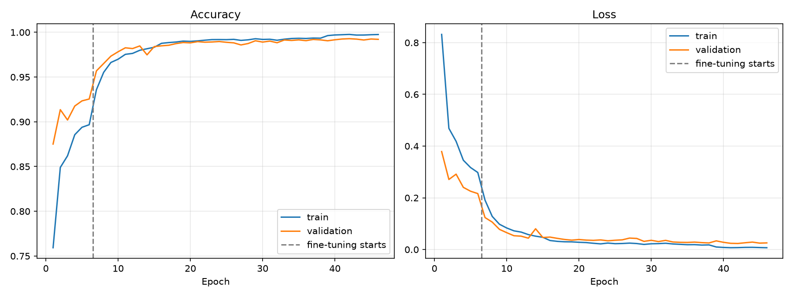

# 🌿 GreenLens — Plant Disease Classification

**GreenLens** is an Algorithms course project by **team Vireon**, supervised by Dr. Fatma Mohamed Talaat.

Detects **38 plant/disease classes** (14 crops, e.g. tomato, potato, apple, grape, corn) from a single leaf photo, using transfer learning on the [PlantVillage dataset](https://www.kaggle.com/datasets/abdallahalidev/plantvillage-dataset).

**🌐 Live demo: [amr-elgharip2006.github.io/Plant-Disease-Classification](https://amr-elgharip2006.github.io/Plant-Disease-Classification/)**. Runs in your browser; photos never leave your device.

[](https://colab.research.google.com/github/amr-elgharip2006/Plant-Disease-Classification/blob/main/notebooks/train_colab.ipynb)

## Features

- **Clean data pipeline.** Uses only the `color` images, drops corrupted files and exact duplicates (MD5), and makes a stratified **70 / 15 / 15** train/val/test split saved to CSV for reproducibility.
- **Streaming `tf.data` input.** Images are read from disk on the fly, so memory use stays small.
- **Augmentation inside the model.** Flips, rotation, zoom, translation, contrast and brightness are re-sampled every epoch and switched off automatically at inference.
- **Two-phase transfer learning:**
  1. Train a new head on a frozen ImageNet backbone (LR `1e-3`).
  2. Unfreeze the whole backbone and fine-tune it (LR `3e-5`). BatchNorm stays frozen.
  3. Optionally continue from the best checkpoint at a lower LR with `--init-from`.
- **Test-time augmentation (TTA).** Predictions average the image with its horizontal and vertical flips, in evaluation and on the website.
- **Training safeguards.** Early stopping, LR reduction on plateau, best-checkpoint saving across both phases, balanced class weights, and optional mixed precision.
- **Full evaluation on the held-out test set.** Accuracy, top-3 accuracy, macro/weighted F1, a per-class report, a confusion matrix, and the most-confused class pairs.
- **Website.** A bilingual (Arabic/English) static site that runs the model in the browser with TensorFlow.js, shows treatment tips per disease, and presents the results (metrics, training curves, confusion matrix). Photos never leave the device, and it works on phones.
- **Inference.** A CLI, a Python API and a Gradio demo.
- **Backbone benchmark.** Compares MobileNetV2, EfficientNetB0 and EfficientNetB2, each at its native resolution.

## Project structure

```
├── plant_disease/          # library code
│   ├── config.py           # hyper-parameters and paths
│   ├── data.py             # download, cleaning, splitting, tf.data pipelines
│   ├── model.py            # backbones, augmentation, head, fine-tuning helpers
│   ├── evaluation.py       # metrics, reports and plots
│   ├── inference.py        # PlantDiseaseClassifier for new images
│   └── labels.py           # "Tomato___Early_blight" → "Tomato — Early blight"
├── explore.py              # EDA: class distribution and sample images
├── benchmark.py            # quick backbone comparison
├── train.py                # two-phase training + test evaluation
├── evaluate.py             # re-evaluate a saved model
├── predict.py              # classify images from the command line
├── app.py                  # Gradio demo
├── export_web.py           # convert the trained model to TensorFlow.js
├── web/                    # static website (index.html, app.js, model/)
└── notebooks/train_colab.ipynb
```

## Quick start

Training runs on **Google Colab** (free GPU):

1. Click the **Open in Colab** badge above.
2. Select `Runtime → Change runtime type → T4 GPU`.
3. Run all cells. The notebook clones this repo, downloads the dataset (about 2 GB) through `kagglehub`, trains, evaluates and opens a demo.

The notebook calls these scripts, and you can also run them in your own Colab cells:

```bash
!python explore.py                                    # download + clean + split + EDA plots
!python benchmark.py --epochs 3                       # optional backbone comparison
!python train.py --backbone efficientnetb0 --mixed-precision
!python predict.py leaf.jpg                           # top-3 predictions
!python app.py --share                                # public Gradio demo link
```

### Python API

```python
from plant_disease.inference import PlantDiseaseClassifier

clf = PlantDiseaseClassifier("artifacts")
for p in clf.predict("leaf.jpg", top_k=3):
    print(p.plant, p.condition, f"{p.confidence:.1%}")
```

## Website

`web/` is a static site, deployed to [GitHub Pages](https://amr-elgharip2006.github.io/Plant-Disease-Classification/) by `.github/workflows/pages.yml` on every push that changes `web/`. You can also host it anywhere else (Hostinger, Netlify, etc.). Inference runs in the visitor's browser, and the float16 model is about 9 MB, downloaded once and then cached.

The converter is installed without its heavy optional dependencies (JAX, decision forests), which `export_web.py` doesn't need:

```bash
pip install --no-deps tensorflowjs==4.22.0 tf-keras tensorflow-hub "setuptools<80"
python export_web.py                                  # artifacts/model.keras → web/model/
python -m http.server 8000 --directory web           # preview at http://localhost:8000
```

## Training outputs

Everything is written to `artifacts/`:

| File | Content |
|---|---|
| `model.keras` | best model (includes augmentation and preprocessing, so it takes raw RGB images) |
| `metadata.json` | class names, image size, training config |
| `splits/{train,val,test}.csv` | exact image lists for each split |
| `history.csv`, `training_curves.png` | per-epoch metrics for both phases |
| `metrics.json`, `classification_report.txt`, `confusion_matrix.png` | test-set evaluation |
| `eda/` | class distribution and sample images |

## Results

EfficientNetB0 (224×224, 4.4M parameters) on the held-out **test set of 8,143 images** that were never used for training or model selection:

| | Accuracy | Top-3 accuracy | Macro F1 |
|---|---|---|---|
| Single view | 99.36% | 99.99% | 99.28% |
| **With TTA (flips)** | **99.39%** | **99.99%** | **99.31%** |

The checkpoint was chosen by validation loss, so the test set is used only for this final measurement. The model was trained on an Apple M4 in about 9 hours:

| Stage | Epochs | LR | Best val accuracy | Test (TTA) |
|---|---|---|---|---|
| Head only (frozen backbone) | 6 | 1e-3 | 92.5% | — |
| Fine-tune full backbone | 20 | 3e-5 → 1.2e-6 | 98.97% | 99.19% |
| Continue (`--init-from`) | 12 | 1e-5 → 2e-6 | 99.15% | 99.30% |
| Continue (`--init-from`) | 8 (early stop) | 5e-6 | 99.29% | **99.39%** |

To reproduce:

```bash
!python train.py                                   # head + full fine-tuning
!python train.py --init-from artifacts/model.keras --output-dir artifacts/round2 --finetune-epochs 12 --finetune-lr 1e-5 --tta
!python train.py --init-from artifacts/round2/model.keras --output-dir artifacts/round3 --finetune-epochs 10 --finetune-lr 5e-6 --tta
```



Most of the remaining errors are between visually similar tomato diseases (spider mites vs. target spot, yellow leaf curl virus vs. bacterial spot). Full matrix: [docs/images/confusion_matrix.png](docs/images/confusion_matrix.png).

## Limitations

- **Lab images.** PlantVillage photos show a single leaf on a plain background under controlled lighting. Models usually score about 99% on this test set but drop noticeably on real field photos with cluttered backgrounds. For deployment, fine-tune on field images too (e.g. [PlantDoc](https://github.com/pratikkayal/PlantDoc-Dataset)).
- **Possible near-duplicate leakage.** The dataset has several photos of the same leaf. Exact duplicates are removed, but near-identical shots can still end up in different splits, which can make test scores optimistic.
- **Class imbalance.** Classes range from roughly 150 to 5,500 images. Balanced class weights and macro F1 are used to account for this.

## Team Vireon

| # | Name | الاسم |
|---|---|---|
| 1 | Amr Ahmed Elgharip Mohamed | عمرو أحمد الغريب محمد |
| 2 | Mohamed Walid Mohamed Mohamed | محمد وليد محمد محمد |
| 3 | Ahmed Ali Mahmoud | أحمد علي محمود |
| 4 | Bola Fady Samir | بولا فادي سمير |
| 5 | Marna Kamal Ali | مرنا كمال علي |
| 6 | Rawan Mohamed Mokhtar | روان محمد مختار |
| 7 | Mariam Abdelmoneim Khalifa | مريم عبد المنعم خليفة |
| 8 | Nouran Amir Abdelwahab | نوران أمير عبد الوهاب |
| 9 | Fatma Ahmed Elhenawy | فاطمة أحمد الحناوي |

**Supervisor:** Dr. Fatma Mohamed Talaat (د. فاطمة محمد طلعت) · **Course:** Algorithms

## Dataset

Hughes & Salathé, *An open access repository of images on plant health to enable the development of mobile disease diagnostics* (2015), via Kaggle.
